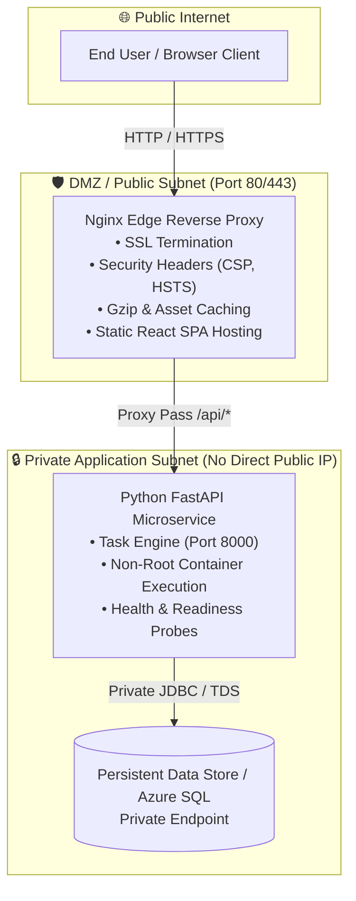

<div align="center">

# Zero-Trust Multi-Tier Application Deployment
### Enterprise Reverse Proxy Edge Routing, Private Subnet Isolation & Shift-Left CI/CD Automation

[](https://dev.azure.com/)
[](https://www.docker.com/)
[](https://nginx.org/)
[](https://fastapi.tiangolo.com/)
[](https://react.dev/)
[](https://trivy.dev/)

<p align="center">
  A production-ready reference architecture showcasing secure multi-tier application hosting. Implements defense-in-depth networking, edge reverse proxy SSL termination, private subnet backend isolation, automated Trivy container vulnerability scanning, and multi-stage Azure DevOps release orchestration.
</p>

</div>

---

## 🏛️ Architecture Overview



---

## 🛡️ Key Architectural & Security Decisions

| Dimension | Legacy Pattern | Enterprise Implementation (This Repo) |
| :--- | :--- | :--- |
| **Network Boundary** | Backend VM exposed directly on public IP | Strict DMZ edge separation; Backend runs in private network without public ingress |
| **API Exposure** | Frontend connects to hardcoded public IP | Nginx reverse-proxies `/api/*` requests internally with connection pooling |
| **Security Headers** | Default webserver headers | Strict CSP, X-Frame-Options (`SAMEORIGIN`), X-Content-Type-Options (`nosniff`) |
| **Container Privilege** | Root container execution | Hardened non-root user (`appuser:10001`) with read-only root filesystems |
| **Supply Chain Security**| Untested base images | Multi-stage Docker builds scanned via Aqua Security Trivy for CVEs |
| **Deployment Model** | Manual shell execution | Automated Azure Pipelines with environment approvals and immutable tags |

---

## 📁 Repository Layout

```tree
secure-multitier-app-deployment/
├── .gitignore                      # Git ignore rules for node_modules, venvs, logs
├── azure-pipelines.yml             # Multi-stage CI/CD: Lint, Unit Test, Trivy Scan, Deploy
├── docker-compose.yml              # Local multi-tier orchestration with isolated bridge networks
├── README.md                       # Architecture runbook and technical specifications
├── nginx/
│   └── nginx.conf                  # Production reverse proxy config with edge security headers
├── backend/
│   ├── app.py                      # FastAPI microservice with /tasks and /healthz endpoints
│   ├── Dockerfile                  # Hardened non-root container definition
│   └── requirements.txt            # Locked Python runtime dependencies
├── frontend/
│   ├── Dockerfile                  # Multi-stage build (Node 18 -> Nginx Alpine)
│   ├── package.json                # React 18 & Material UI dependencies
│   ├── public/                     # Static assets & HTML template
│   └── src/
│       ├── TodoApp.js              # Environment-aware API client component
│       ├── index.js                # App entrypoint
│       └── theme.js                # Visual theme system
└── systemd/
    └── todo-backend.service        # Production Linux systemd service unit with sandboxing
```

---

## 🚀 Quickstart & Verification

### 1. Run Complete Multi-Tier Stack Locally via Docker Compose

```bash
# Clone the repository
git clone https://github.com/samarendra12/secure-multitier-app-deployment.git
cd secure-multitier-app-deployment

# Launch edge proxy, frontend, and backend in isolated networks
docker compose up -d --build

# Verify running containers
docker compose ps
```

Access the application:
- **Web UI & Reverse Proxy**: [http://localhost](http://localhost)
- **Direct API Health Probe via Proxy**: [http://localhost/api/healthz](http://localhost/api/healthz)

### 2. Run Backend Tests & Verification

```bash
cd backend
python -m venv venv
source venv/bin/activate  # On Windows: .\venv\Scripts\Activate.ps1
pip install -r requirements.txt
python -c "import app; print('Backend module verified successfully')"
```

---

## 🔄 Azure DevOps CI/CD Lifecycle

The pipeline [`azure-pipelines.yml`](azure-pipelines.yml) enforces a zero-trust build and release gate:

1. **`TestAndValidate` Stage**:
   - Executes `npm test` across frontend components.
   - Executes Python dependency and schema validation.
2. **`SecurityScan` Stage**:
   - Builds immutable candidate images.
   - Scans images with Trivy targeting `HIGH` and `CRITICAL` severity CVEs.
3. **`DeployStaging` Stage**:
   - Evaluates environment approval policies.
   - Performs automated rolling deployment into target runtime.

---

## 👤 Author & Architecture Inquiries

**Samarendra Kumar**  
*Senior Azure DevOps Engineer & Cloud Platform Architect*  
- **GitHub**: [@samarendra12](https://github.com/samarendra12)  
- **LinkedIn**: [linkedin.com/in/samarendra-kumar](https://linkedin.com/in/samarendra-kumar)  
- **Email**: [samarendra.azuredevops@gmail.com](mailto:samarendra.azuredevops@gmail.com)
